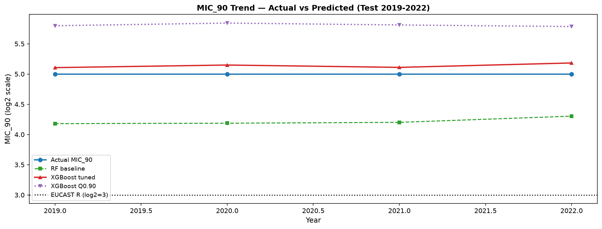

# Model Training Results — A. baumannii + Meropenem
**Generated**: 2026-07-02 19:31
---
## Evaluation Metrics
| Model | RMSE (all) | MAE (all) | R2 (all) | RMSE (R subset) | MAE (R subset) | N resistant |
|---|---|---|---|---|---|---|
| RF baseline | 2.6066 | 2.1387 | 0.2760 | 1.8338 | 1.5915 | 9,415 |
| XGBoost tuned | 2.7354 | 1.7867 | 0.2027 | 1.0650 | 0.7205 | 9,415 |
| XGBoost Q0.90 | 4.1073 | 2.7902 | -0.7976 | 0.9519 | 0.8652 | 9,415 |

> **Note**: RMSE on the resistant subset (MIC >= 8 mg/L) is the clinically relevant metric. The full-set RMSE is dominated by the ~75% of isolates imputed at the censoring floor (log2=-5).

---

## MIC_90 Trend — Actual vs Predicted



---

## Residuals by Year


---

## RMSE by Year


---

## SHAP Feature Importance


---

## XGBoost Best Hyperparameters (Optuna)

```json
{
  "n_estimators": 1200,
  "max_depth": 8,
  "learning_rate": 0.022850767635951338,
  "subsample": 0.6234360427768588,
  "colsample_bytree": 0.5461460258626638,
  "min_child_weight": 19,
  "gamma": 1.4941537222548376,
  "reg_alpha": 2.1123234595677163,
  "reg_lambda": 8.877591523343991
}
```

---

## Next Steps

- Review SHAP values with domain expert — confirm biological plausibility
- Build FastAPI endpoint: `src/api/main.py`
- Push model artefact to Hugging Face Hub
- Prepare submission write-up
