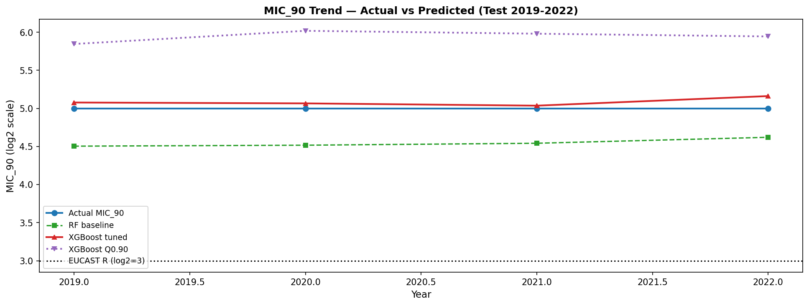

# Model Training Results — K. pneumoniae + Meropenem
**Generated**: 2026-07-02 19:29
---
## Evaluation Metrics
| Model | RMSE (all) | MAE (all) | R2 (all) | RMSE (R subset) | MAE (R subset) | N resistant |
|---|---|---|---|---|---|---|
| RF baseline | 1.8659 | 1.2479 | 0.7413 | 3.3630 | 2.6813 | 4,305 |
| XGBoost tuned | 2.0480 | 1.5759 | 0.6883 | 2.5602 | 1.6596 | 4,305 |
| XGBoost Q0.90 | 3.5685 | 2.8539 | 0.0537 | 1.6002 | 1.1706 | 4,305 |

> **Note**: RMSE on the resistant subset (MIC >= 8 mg/L) is the clinically relevant metric. The full-set RMSE is dominated by the ~75% of isolates imputed at the censoring floor (log2=-5).

---

## MIC_90 Trend — Actual vs Predicted



---

## Residuals by Year


---

## RMSE by Year


---

## SHAP Feature Importance


---

## XGBoost Best Hyperparameters (Optuna)

```json
{
  "n_estimators": 500,
  "max_depth": 8,
  "learning_rate": 0.011079656795446676,
  "subsample": 0.9991613164008715,
  "colsample_bytree": 0.5004682683429197,
  "min_child_weight": 16,
  "gamma": 1.821066018263355,
  "reg_alpha": 1.4426389041559888,
  "reg_lambda": 1.9401903228972701
}
```

---

## Next Steps

- Review SHAP values with domain expert — confirm biological plausibility
- Build FastAPI endpoint: `src/api/main.py`
- Push model artefact to Hugging Face Hub
- Prepare submission write-up
